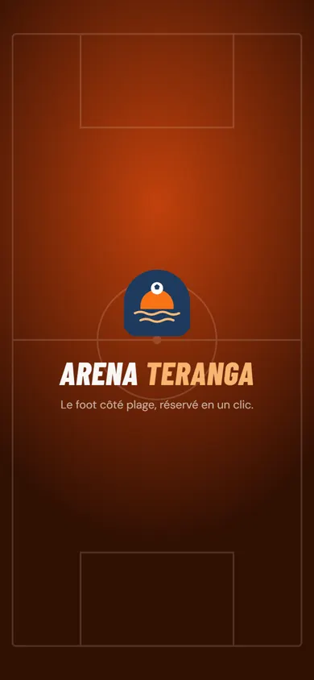
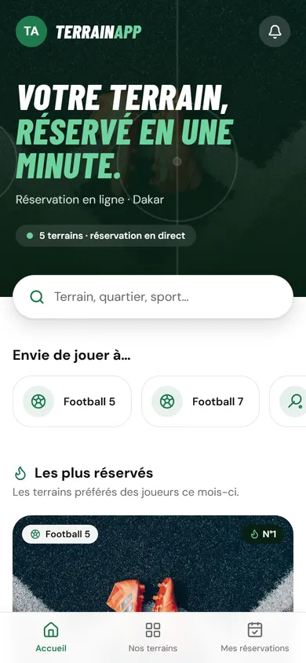
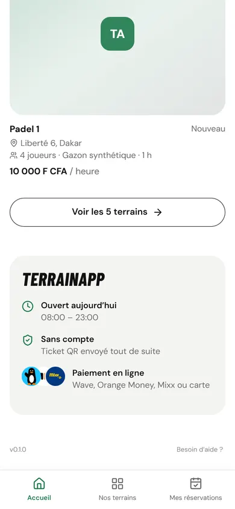
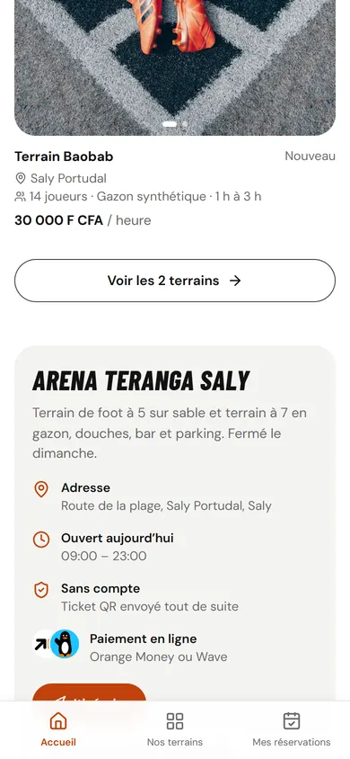
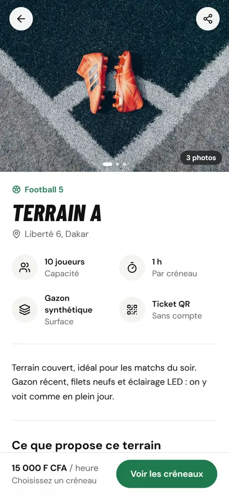
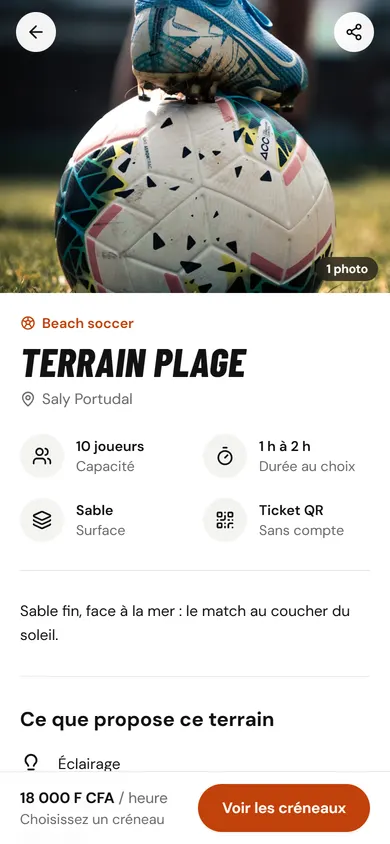
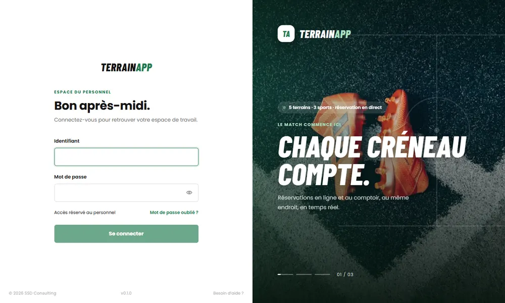
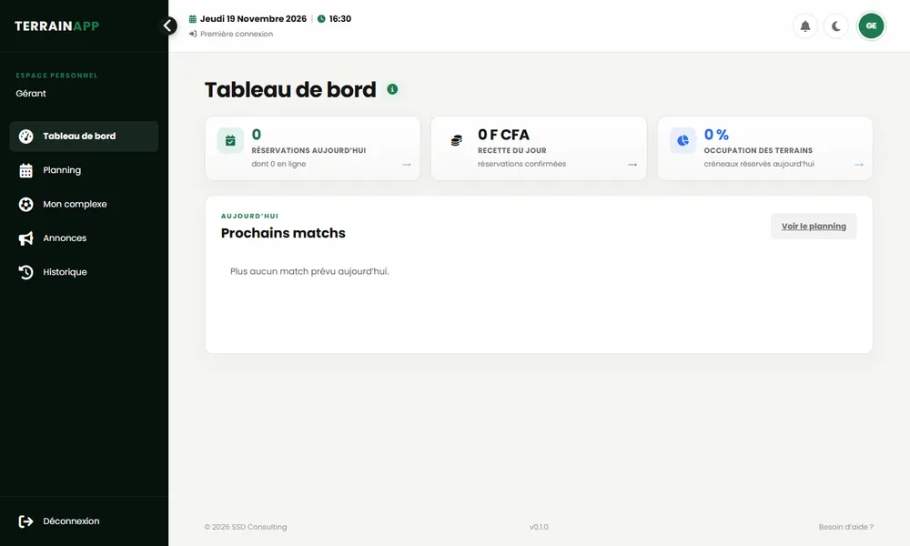
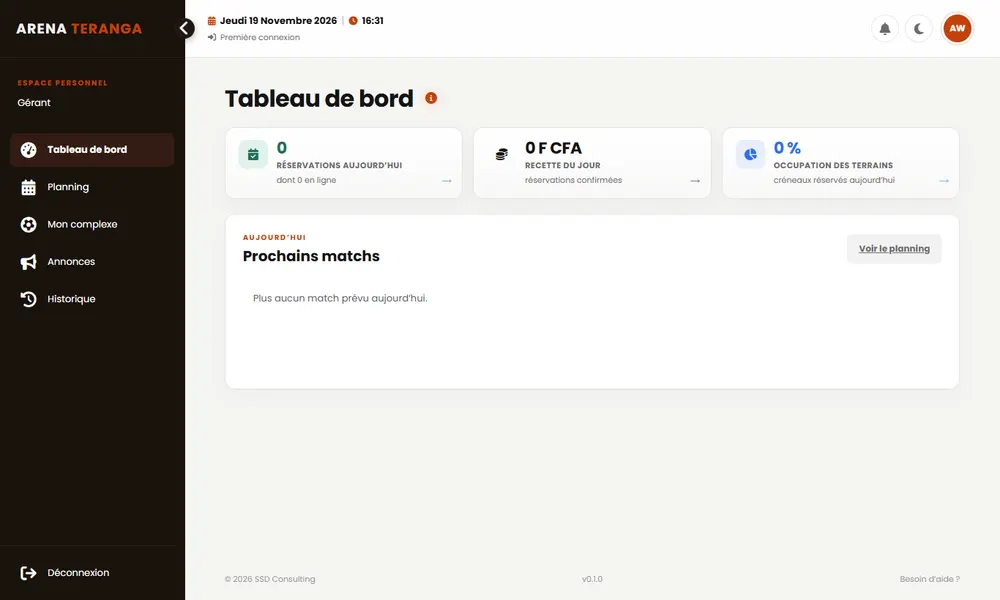

# Démonstration : un complexe fictif, avant / après

Même code, mêmes images Docker. Seul change le dossier du complexe.

- **Avant** : images lancées sans dossier (`avant-docker-compose.yml`). Marque TerrainApp par défaut,
  données de démonstration du profil dev.
- **Après** : complexe fictif **Arena Teranga** (Saly), dossier [`arena-teranga/`](arena-teranga/),
  rangé hors du dépôt comme le serait un vrai client dans `Clients_TerrainApp`, puis :

```bash
cd outils/personnaliser
npm run client -- ../../docs/demonstration/arena-teranga --profil demo --images-locales
cd ../../deploiements/arena-teranga && docker compose up -d --wait
```

Ce qui change, sans toucher au code : nom, logo, couleurs (orange `#C2410C` et teinte foncée
`#7C2D12`), slogan et textes d'accueil, image d'accueil, sports et terrains, annonce de lancement,
moyens de paiement (Orange Money et Wave seulement), horaires (fermé le dimanche), délai
d'annulation de 12 h, marge d'entrée de 20 min, nom sur les tickets, favicon, icônes et manifeste
PWA (`"short_name": "Arena Teranga"`), titre du Manager (« Arena Teranga Manager »), compte du
personnel activé par code à usage unique.

Le backend charge les données une seule fois. Au redémarrage, il écrit
`Donnees du complexe : 0 element(s) cree(s), 8 deja present(s)`.

## App des joueurs

| | Avant | Après |
|---|---|---|
| Démarrage |  |  |
| Annonce |  |  |
| Accueil |  |  |
| Le complexe |  |  |
| Terrain |  |  |

## Manager

| Avant | Après |
|---|---|
|  |  |
| (compte de démonstration) |  Première connexion avec le code d'activation |
|  |  |
